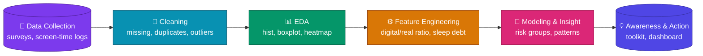
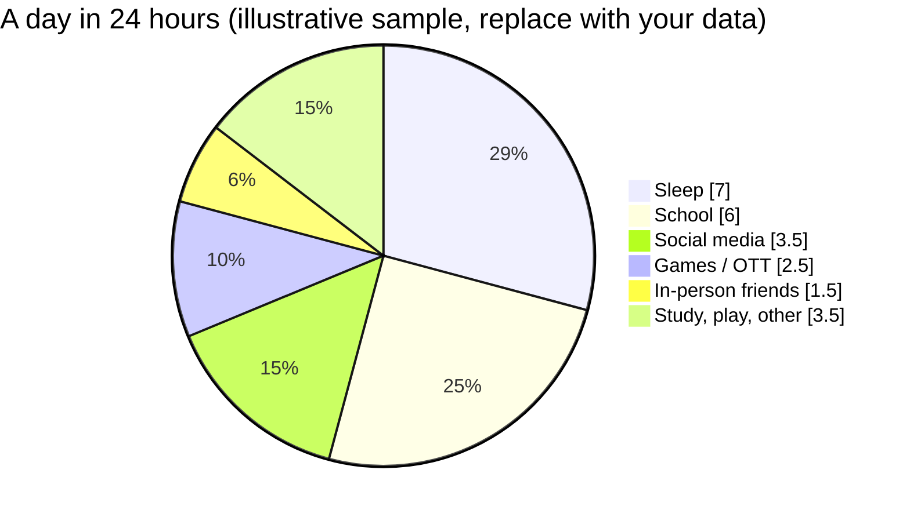
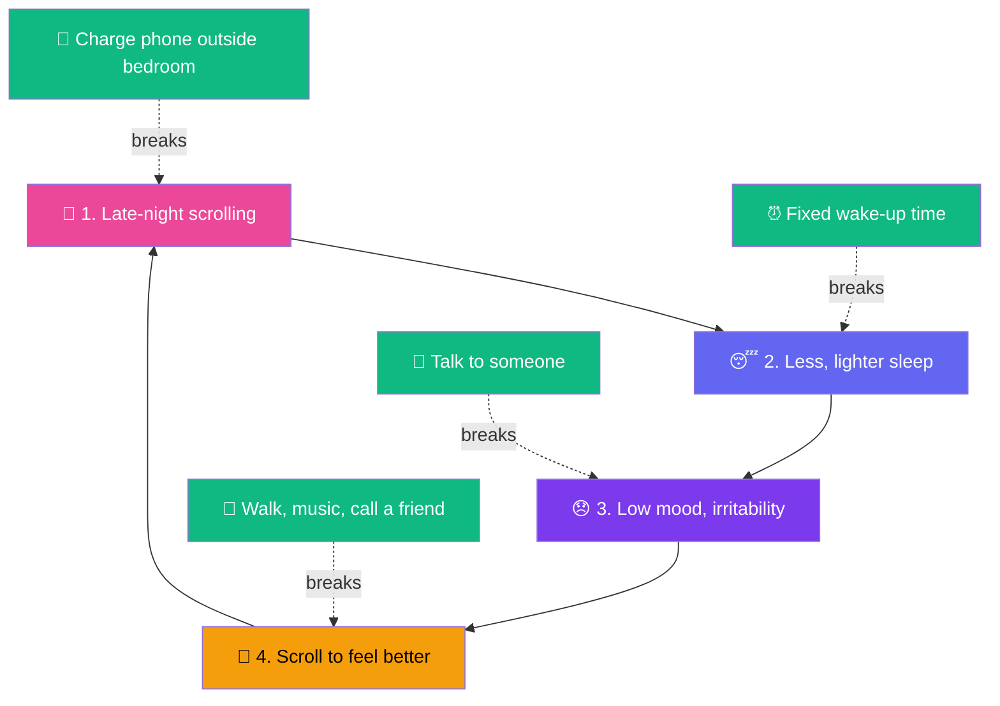

<div align="center">


<a href="https://git.io/typing-svg">
  
</a>

<br/>


**[Overview](#-overview) · [Architecture](#%EF%B8%8F-project-architecture) · [3D Model](#-3d-conceptual-model) · [Day](#%EF%B8%8F-where-the-day-goes) · [Loop](#-the-scroll-loop) · [Analysis](#-analysis-plan) · [Quests](#-real-life-quests) · [Help](#-getting-help)**

</div>

---

## 🎯 Overview

> **In today's world, where does a teenager's time actually go, and what happens when screen life grows bigger than real life?**

This project explores teen **screen habits, sleep, mood and real-life connection** using exploratory data analysis (EDA) and clear visual storytelling, so that a teen, a parent and a teacher can all understand the results.

| 🎯 Goal | 🧪 Method | 📦 Output |
|---|---|---|
| Understand daily time use, screen habits, sleep and mood | Clean data, explore with plots, build features, find patterns | Insights, a habit toolkit and a visual guide |

> [!NOTE]
> This project describes patterns and builds awareness. It **does not diagnose** anyone. Screens are not the enemy, **imbalance** is the risk.

### 🧭 Choose your path

<table>
<tr>
<td align="center">🧑‍🎓<br/><b>I am a teen</b><br/><a href="#-real-life-quests">Real-Life Quests</a></td>
<td align="center">👨‍👩‍👧<br/><b>Parent / teacher</b><br/><a href="#-warning-signs">Warning Signs</a></td>
<td align="center">📊<br/><b>Data learner</b><br/><a href="#-analysis-plan">Analysis Plan</a></td>
</tr>
</table>

---

## 💭 Why It Matters

Social media brings connection, creativity and community. It also puts **comparison, pressure and endless content** in a teen's pocket, day and night. Research links heavy, late-night or purely passive use with poorer sleep, lower mood and more anxiety in *some* teens; effects differ from person to person.

- ⏳ Online time often **replaces** sleep, movement, homework and face-to-face talk.
- ❤️ Likes, streaks and follower counts can quietly become a measure of self-worth.
- 🌐 Cyberbullying and FOMO follow teens home, there is no off switch.
- 🧩 Real-life skills, like handling boredom or conflict, get less practice.

---

## 🏗️ Project Architecture



| Stage | What happens | Tools |
|---|---|---|
| 1️⃣ Data Collection | Survey answers, app screen-time exports, sleep and mood self-ratings | CSV, forms |
| 2️⃣ Cleaning | Fix missing values, duplicates, impossible hours (>24 h), wrong types | Pandas, NumPy |
| 3️⃣ EDA | Histograms, count plots, boxplots, correlation heatmap | Matplotlib, Seaborn |
| 4️⃣ Features | Digital-to-real ratio, night-use flag, sleep debt | Pandas |
| 5️⃣ Insight | Group teens by habits, compare mood and sleep across groups | SciPy, scikit-learn |
| 6️⃣ Action | Turn findings into a toolkit for teens, parents and schools | Docs, dashboards |

---

## 🧊 3D Conceptual Model

Wellbeing is a **tower of five floating layers**. Sleep and real bonds are the foundation; social media and comparison sit on top. When the top grows heavy, the tower wobbles, and **sleep and connection slip first**.

```text
        ╱▔▔▔▔▔▔▔▔▔▔▔▔▔▔▔▔▔╲
       ╱ 5 PRESSURE &       ╲      likes, FOMO, trends
      ╱   COMPARISON         ╲
      ▔▔▔▔▔▔▔▔▔▔▔▔▔▔▔▔▔▔▔▔▔▔▔
        ╱▔▔▔▔▔▔▔▔▔▔▔▔▔▔▔▔▔╲
       ╱ 4 SOCIAL MEDIA     ╲      feeds, reels, chats
      ╱   LIFE               ╲
      ▔▔▔▔▔▔▔▔▔▔▔▔▔▔▔▔▔▔▔▔▔▔▔
        ╱▔▔▔▔▔▔▔▔▔▔▔▔▔▔▔▔▔╲
       ╱ 3 MOOD & EMOTIONS  ╲      stress, joy, self-worth
      ╱                      ╲
      ▔▔▔▔▔▔▔▔▔▔▔▔▔▔▔▔▔▔▔▔▔▔▔
        ╱▔▔▔▔▔▔▔▔▔▔▔▔▔▔▔▔▔╲
       ╱ 2 REAL-LIFE BONDS  ╲      family, friends, school
      ╱                      ╲
      ▔▔▔▔▔▔▔▔▔▔▔▔▔▔▔▔▔▔▔▔▔▔▔
        ╱▔▔▔▔▔▔▔▔▔▔▔▔▔▔▔▔▔╲
       ╱ 1 SLEEP & BODY     ╲      rest, food, movement
      ╱                      ╲
      ▔▔▔▔▔▔▔▔▔▔▔▔▔▔▔▔▔▔▔▔▔▔▔
          foundation: protect these first
```

<details>
<summary><b>🔍 Click to expand: healthy vs. under strain</b></summary>

<br/>

| Layer | Healthy state | Under strain |
|---|---|---|
| 🌙 Sleep & Body | 8 to 10 hours, regular meals, some movement | Late nights, skipped meals, tired all day |
| 🤝 Real-Life Bonds | Talks with family, time with friends in person | Meals with phones, fewer plans made |
| 💜 Mood & Emotions | Can name feelings, bounces back from bad days | Irritable, flat, anxious, withdrawn |
| 📱 Social Media Life | Creating, chatting, learning, in moderation | Doomscrolling, passive checking for hours |
| 🎭 Pressure & Comparison | Aware that feeds are highlight reels | Self-worth tied to likes and filters |

</details>

> 🌐 **Want the animated 3D version?** Open `Teen_Mental_Health_README.html` in a browser (or publish it with GitHub Pages) to see the rotating 3D tower.

---

## ⏱️ Where the Day Goes

A day has 24 hours. Every hour given to the feed is taken from something else, usually sleep first.



> In this sample, **social media + games (6 h) is 4x the time with friends in person (1.5 h)**. That ratio becomes the `digital_real_ratio` feature in the analysis.

---

## 🔁 The Scroll Loop

Harm rarely comes from one big moment. It builds as a loop that feeds itself.



---

## 🔄 Habits and Swaps

| ⚠️ Harmful habit | What it does | ✅ Healthier swap |
|---|---|---|
| Scrolling in bed | Delays sleep, fragments rest | Charge the phone across the room, use an alarm clock |
| Doomscrolling | Raises worry, drains energy | Set a timer, pick a feed with a clear end |
| Comparing with filtered lives | Lowers self-image, fuels envy | Follow people who teach or inspire, mute the rest |
| Replacing meals and movement | Low energy, low mood | Phone-free meals, 20 minutes outside daily |
| Chasing likes and streaks | Approval becomes the goal | Post for fun, hide counts, track real wins |
| Hiding cyberbullying | Isolation, fear, shame | Screenshot, block, tell a trusted adult |
| Gaming through the night | Sleep debt, falling grades | Agreed stop time, weekends get more room |

---

## 🚨 Warning Signs

No single sign means something is wrong. Look for **changes lasting two weeks or more**, or several together.

<details>
<summary><b>👀 What to notice</b></summary>

<br/>

- Sleeping much more or much less, constant tiredness
- Pulling away from friends, family or hobbies once loved
- Mood swings, anger, tears, or a flat, empty tone
- Falling grades, skipped school, trouble focusing
- Distress without the phone, or secrecy about online life
- Talk of feeling worthless, hopeless or like a burden

</details>

<details>
<summary><b>💬 How to start the talk</b></summary>

<br/>

- Pick a calm moment, not an argument. Walks and car rides work well.
- Say what you see, without blame: *"You seem more tired lately. I am here if you want to talk."*
- Listen first. Do not rush to fix, lecture or take the phone away.
- Ask what their online life feels like, the good and the hard.
- Offer to find support together, starting with a school counselor or doctor.

</details>

---

## 📊 Analysis Plan

**Questions the data should answer**

- How many hours a day do teens spend on social media, and how does it vary by age and gender?
- Is more screen time linked to less sleep and lower mood?
- Does night-time use matter more than total hours?
- Do teens with more in-person time report better mood?
- Which groups look most at risk, and what do their habits share?

<details>
<summary><b>🐍 Click to expand: starter code</b></summary>

```python
import pandas as pd, numpy as np
import seaborn as sns, matplotlib.pyplot as plt

df = pd.read_csv("data/teen_mental_health.csv")
df.info(); print(df.isnull().sum())

# --- clean
df = df.drop_duplicates()
df = df[df["social_media_hrs"].between(0, 24)]
df["sleep_hrs"] = df["sleep_hrs"].fillna(df["sleep_hrs"].median())

# --- features
df["digital_hrs"] = df["social_media_hrs"] + df["gaming_hrs"]
df["digital_real_ratio"] = df["digital_hrs"] / (df["in_person_hrs"] + 1)
df["sleep_debt"] = (8 - df["sleep_hrs"]).clip(lower=0)
df["night_user"] = (df["last_screen_hour"] >= 23).astype(int)

# --- explore
sns.histplot(df["social_media_hrs"], kde=True)
sns.boxplot(x="night_user", y="mood_score", data=df)
sns.heatmap(df.corr(numeric_only=True), annot=True, cmap="coolwarm")
plt.show()
```

</details>

---

## 📂 Repository Structure

```text
📦 teen-mental-health
 ┣ 📂 data
 ┃ ┣ 📜 teen_mental_health.csv
 ┃ ┗ 📜 cleaned_data.csv
 ┣ 📂 notebooks
 ┃ ┗ 📓 01_eda_cleaning_analysis.ipynb
 ┣ 📂 assets
 ┃ ┣ 🖼️ histogram.png
 ┃ ┣ 🖼️ boxplot.png
 ┃ ┗ 🖼️ heatmap.png
 ┣ 🌐 Teen_Mental_Health_README.html
 ┣ 📜 requirements.txt
 ┗ 📜 README.md
```

## 🛠️ Getting Started

```bash
# 1. Clone
git clone https://github.com/<your-username>/teen-mental-health.git
cd teen-mental-health

# 2. Environment (optional)
python -m venv venv
source venv/bin/activate        # Windows: venv\Scripts\activate

# 3. Install
pip install pandas numpy matplotlib seaborn scikit-learn jupyter

# 4. Run
jupyter notebook
```

---

## 🎮 Real-Life Quests

Copy this list into an issue, a note or a printout, and tick one quest a day for a week.

**Level 1: Sleep**
- [ ] Charge the phone outside the bedroom tonight
- [ ] No screens for the last 30 minutes before sleep
- [ ] Wake up at the same time for 5 days

**Level 2: Connection**
- [ ] One phone-free meal with family
- [ ] Meet or call a friend instead of texting
- [ ] Ask someone how they really are, and listen

**Level 3: Body and mind**
- [ ] 20 minutes outside, no phone in hand
- [ ] Try a hobby with no screen (draw, play, cook, build)
- [ ] Write down 3 good things from the day

**Level 4: Feed cleanup**
- [ ] Mute or unfollow 5 accounts that make you feel worse
- [ ] Turn off non-essential notifications
- [ ] Set a daily limit and keep it for a week

**Boss level**
- [ ] Tell a trusted person one thing that has been weighing on you

> **Score:** 0 to 4 = just starting · 5 to 9 = building momentum · 10 to 13 = balanced and strong. The goal is progress, not perfection.

---

## 💚 Getting Help

> [!IMPORTANT]
> **You are not alone, and asking for help is a sign of strength.** If you or a teen you know feels hopeless, unsafe or thinks about self-harm, talk to a trusted adult today, such as a parent, school counselor or doctor.
> In India, **Tele-MANAS (14416)** offers free mental health support, and **112** is the emergency number if someone is in immediate danger. Elsewhere, please use your local helpline or emergency number.

### 🛡️ Ethics checklist for the data work

- [x] Collect data only with consent, from teens and guardians where required
- [x] Anonymize everything: no names, schools or contact details
- [x] Report patterns, never label or diagnose individuals
- [x] Show uncertainty: correlation is not causation

---

## 🚀 Roadmap

- [x] Define the questions and project architecture
- [x] Design the 3D conceptual model and visual guide
- [ ] Collect or select a dataset and run the EDA notebook
- [ ] Add a Streamlit or Plotly dashboard for live exploration
- [ ] Share a one-page parent and teacher guide

---

<div align="center">

### 🤝 Connect

[](https://linkedin.com/in/your-profile)
[](https://github.com/your-username)

⭐ **If this project helped you, drop a star!** ⭐

`#TeenMentalHealth` `#DataAnalytics` `#EDA` `#Python` `#DigitalWellbeing` `#MentalHealthAwareness`

*Built with Python, curiosity and care. Real life is the main feed.*


</div>
